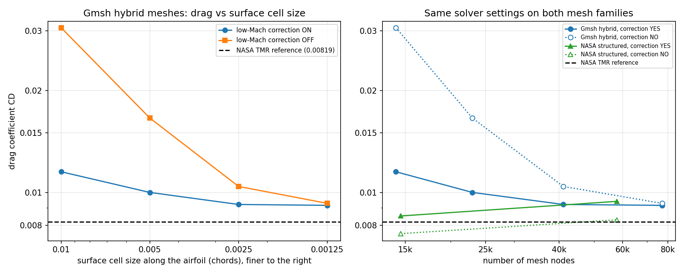

# NACA 0012 airfoil CFD mesh study (Gmsh + SU2)

A mesh-sensitivity study of a 2D NACA 0012 airfoil (the cross-section of a wing), meshed with
[Gmsh](https://gmsh.info) and solved with [SU2](https://su2code.github.io), checked against NASA's
Turbulence Modeling Resource (TMR) validation case.

Everything runs from one script in a free Google Colab notebook. This is an independent,
not-yet-peer-reviewed project, and the numbers below come from single runs.

## The case

| | |
|---|---|
| Airfoil | NACA 0012, chord = 1, sharp trailing edge |
| Flow | Mach 0.15, Reynolds number 6 million (per chord), 300 K, angle of attack 0 degrees |
| Model | RANS with the Spalart-Allmaras turbulence model, fully turbulent |
| Reference | NASA TMR NACA 0012 validation case: drag coefficient CD = 0.00819 (CFL3D, Spalart-Allmaras) |
| Software | Gmsh 4.15.2, SU2 v8.5.0 |

The reference value was taken from a secondary tabulation of the TMR data. Please check it against
the TMR page (https://tmbwg.github.io/turbmodels/naca0012_val.html) before citing it.

## Results



Drag coefficient CD on our Gmsh meshes (boundary-layer quads near the wall, triangles elsewhere).
The surface cell size is the cell size along the airfoil, in chords. All other mesh settings are
fixed (see "Settings").

| Surface cell size | Nodes | CD, low-Mach correction ON | CD, low-Mach correction OFF |
|---|---|---|---|
| 0.01 | 14,119 | 0.011507 (+40.5%) | 0.030641 (+274%) |
| 0.005 | 23,008 | 0.009999 (+22.1%) | 0.016575 (+102%) |
| 0.0025 | 41,090 | 0.009213 (+12.5%) | 0.010414 (+27.2%) |
| 0.00125 | 77,178 | 0.009158 (+11.8%) | 0.009283 (+13.3%) |

The same solver settings on NASA's own structured grids (SU2 TestCases repository, `rans/naca0012`):

| NASA grid | Nodes | CD, correction ON | CD, correction OFF |
|---|---|---|---|
| 225 x 65 | 14,576 | 0.008521 (+4.0%) | 0.007557 (-7.7%) |
| 449 x 129 | 57,824 | 0.00941 (+14.9%) | 0.00830 (+1.4%) |

Percentages are relative to the reference CD = 0.00819. The full table is in
[`results/results_summary.csv`](results/results_summary.csv).

## What we found

1. **The solver setup reproduces the reference on NASA's grids.** With the low-Mach correction off,
   SU2 gives CD = 0.00830 on the 449 x 129 grid (+1.4%).
2. **Our Gmsh meshes converge to CD of about 0.0092, roughly 12% above the reference.** With the
   correction on, successive refinements change CD by 13%, 8%, and then 0.6%. A gap remains and we
   have not identified its cause.
3. **The low-Mach correction setting matters a lot on coarse meshes and little on fine ones.** On the
   coarsest Gmsh mesh it changes CD by a factor of 2.7. On the finest it changes CD by 1.4%. On NASA's
   two grids it changes CD by about 13%: it moves the result away from the reference on the 449 x 129
   grid (+14.9% instead of +1.4%) and toward it on the 225 x 65 grid (+4.0% instead of -7.7%).
4. **One setting helps convergence without changing the answer.** Adding
   `REF_DIMENSIONALIZATION= FREESTREAM_PRESS_EQ_ONE` (taken from SU2's own NACA 0012 test case) took the
   density residual on the 449 x 129 grid from about -6.4 to about -9.2, with CD unchanged (0.00941).

## How to run it (Google Colab)

1. Go to [colab.research.google.com](https://colab.research.google.com) and open a new notebook.
2. Click the folder icon on the left, then the upload icon, and upload `naca0012_study.py`.
3. In a notebook cell, run:

   ```
   %run -i naca0012_study.py
   ```

   The first run installs Gmsh and downloads SU2, which adds a few minutes. A run on the 23,000-node
   mesh takes about 10 to 15 minutes.
4. To change a setting without editing the file, define `OVERRIDES` before running. For example, the
   finest mesh with the correction off:

   ```
   OVERRIDES = {"LC_AIRFOIL": 0.00125, "LOW_MACH_CORR": "NO"}
   %run -i naca0012_study.py
   ```

   Setting names are checked, so a typo such as `"LC_AIRFOL"` stops the run with a clear message
   instead of being ignored. The valid names are listed in `DEFAULTS` at the top of the script.
5. To build and check only the mesh, without the solver (about a minute), use
   `OVERRIDES = {"MESH_ONLY": True}`.

Each run adds a line to `results_log.csv` and saves `mesh.png` and `convergence.png`. The log records
the settings, the Gmsh and SU2 versions, the run time, and whether the convergence check passed.
The results of the latest run are also left in the notebook variable `LAST_RESULT`.
Colab deletes its files when a session ends, so download what you want to keep.

## Settings used for the results above

| Setting | Value |
|---|---|
| First cell height | 4.457e-6 chord (estimated y+ of about 1, flat-plate correlation) |
| Boundary-layer cells | growth ratio 1.2 (41 layers), block thickness 0.04 chord |
| Outer boundary | circle of radius 100 chords, cell size 20 at the edge |
| Tail refinement | cell size 0.005 at the trailing edge, growing by 0.1 per unit distance |
| Flux scheme | Roe, second-order, Venkatakrishnan-Wang limiter (coefficient 0.05) |
| Turbulence advection | second-order (`MUSCL_TURB= YES`) |
| Time stepping | implicit, adaptive CFL starting at 1.0, 3000 iterations |
| Other | `REF_DIMENSIONALIZATION= FREESTREAM_PRESS_EQ_ONE`, `LOW_MACH_CORR` as stated per run |

## Checks built into the script

- Unknown setting names and unusable values are rejected before anything runs.
- Gmsh (4.15.2) and SU2 (v8.5.0) are pinned to the versions used for the results, and the versions
  used are written to the log.
- The mesh file is checked for the `airfoil` and `farfield` boundaries before the solver starts.
- Files from an earlier run are deleted before SU2 starts, so old results cannot be read by mistake.
- After each run the script checks that the density residual is below -6 and that CD changed by less
  than 0.5% over the last 100 iterations. If not, it prints a warning and marks the run
  `converged = NO` in the log.
- The comparison with NASA's values is only made for an angle of attack of 0 degrees.

## Testing

`tests/test_study.py` checks the parts of the script that do not need Gmsh or SU2: the settings
checks, the SU2 settings file (compared with the file used for the published runs), reading SU2's
output files, the convergence check, the results log, and the call sequence sent to Gmsh (using a
stand-in for Gmsh). It needs only `numpy` and `matplotlib`:

```
python tests/test_study.py
```

These tests do not replace a real run. They cannot show that Gmsh builds a good mesh or that SU2
converges. For that, the final script was run in a fresh Google Colab session on 17 October 2026:
the four mesh sizes gave 14,119, 23,008, 41,091, and 77,178 nodes (published runs: 14,119, 23,008,
41,090, and 77,178), and a full run at surface cell size 0.005 gave CD = 0.009999, the same as the
published value, with the convergence check passing.

## Repository contents

| File | What it is |
|---|---|
| `naca0012_study.py` | The whole study: mesh, solver settings, run, checks, results log |
| `tests/test_study.py` | Tests for the parts that need neither Gmsh nor SU2 |
| `results/results_summary.csv` | The results tables above, as data |
| `results/convergence_cd.png` | The convergence figure |
| `requirements.txt` | Python packages (Gmsh is installed with pip; SU2 is downloaded by the script) |

## Limitations

- Two-dimensional, one airfoil, one angle of attack (0 degrees).
- The four-mesh series varies only the surface cell size. Other mesh parameters were varied in the
  exploratory runs below, under earlier solver settings.
- The lift coefficient should be zero for this symmetric case. It is not exactly zero on our Gmsh meshes
  (up to about 0.006 in magnitude) because the unstructured mesh is not perfectly symmetric.
- Single runs, one solver version, no formal uncertainty estimate. Gmsh node counts can differ by a
  node or two between runs of the same settings. The change in CD between successive
  meshes is not a clean asymptotic sequence, so we do not report a grid convergence index.
- The remaining 12% gap to the reference is unexplained.

## Exploratory runs with earlier solver settings

These were run before the settings above were final (no `REF_DIMENSIONALIZATION`, low-Mach correction on,
surface cell size 0.005). They are indicative only and have not been repeated under the final settings.

| Change | CD |
|---|---|
| Baseline (outer radius 50, far cell size 10) | 0.010521 |
| Outer radius 25 chords | 0.019034 |
| Outer radius 100 chords (far cell size 20) | 0.010518 |
| Boundary-layer block thickness 0.02 / 0.08 | 0.011562 / 0.010363 |
| Growth ratio 1.3 | 0.010396 |
| y+ 0.25 / 0.5 / 1 / 2 (far cell size 5) | 0.010531 / 0.010271 / 0.010039 / 0.009242 |

## Credits

- NASA Turbulence Modeling Resource, NACA 0012 validation case.
- SU2 and its TestCases repository (the structured NASA grids and the reference settings file).
- Gmsh.

## License

MIT, see `LICENSE`.
